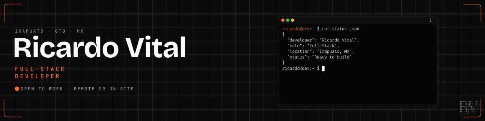

<!--
  ==========================================================================
  LINKS — single source of truth (reference-style definitions live at the
  bottom of this file, just before the closing comment). If a URL changes,
  update the definition there once and every link follows.

  portfolio : https://rvital.dev
  rms repo  : https://github.com/Ricardo-Vtl/Restaurant-Management-System-RMS-Demo
  rms demo  : https://rms.rvital.dev
  deckcraft : https://github.com/Ricardo-Vtl/DeckCraft
  linkedin  : https://www.linkedin.com/in/ricardo-vital-dev
  email     : vitalnegretericardo@gmail.com

  ASSETS (all live in assets/, SVG, scale via width="100%"):
    banner.svg       1200x300  bg #0a0a0a, accent #ff6b35, terminal mockup
    divider.svg      1200x16   accent #ff6b35 glow line (1192x10, r5)
    footer-mark.svg  1200x80   wordmark #ff6b35 + #8a8a8a
  Every "---" between sections is the divider; footer-mark sits above the
  "Open to work" line.

  ANALYTICS — services + palette (bg 0a0a0a · accent ff6b35 · text c9d1d9 ·
  muted 8a8a8a · line 30363d/1c2128). All best-effort public instances:
    stats / top-langs : https://github-readme-stats.vercel.app/api
    streak            : https://streak-stats.demolab.com  (was herokuapp, dead)
    activity graph    : https://fabianocouto-activity-graph.vercel.app/graph
                        (upstream vercel paused/billing-locked -> community mirror)
  ==========================================================================
-->

  

  
  
  

## About

Self-taught full-stack developer, building complete web products end to end since August 2024 — requirements, architecture, code, security, deploy, docs. I paused a 10-semester Computer Systems Engineering program (TecNM) to learn by shipping real software instead; training as a Mechatronics technician is where the hardware-and-code habit started.

I care more about solid engineering underneath than about what merely looks good — I adopt new tools only when they bring real gains in performance, maintainability and developer experience.

**Now:** RMS is live (demo below) and still evolving, alongside my bilingual (EN/ES) portfolio site.

On-site in Irapuato, Mexico · full remote elsewhere · available immediately.

  

## Featured projects

### [Restaurant Management System (RMS)][repo]
White-label restaurant management platform, built and shipped end to end: public landing with a live digital menu and online ordering — plus a 9-module panel (Dashboard, Tables, Orders, Kitchen KDS, Cashier, Menu, Inventory, Staff, Settings). API-only writes with atomic PostgreSQL RPCs, row-level security, Zod validation at every boundary, real-time sync and rate limiting.

Client read-only over RLS + Realtime · service-role Route Handlers · SQL migrations · Vitest suite · full technical documentation. 36 commits, feature-based clean architecture.

**Stack:** Next.js 16 · React 19 · TypeScript (strict) · Supabase (PostgreSQL, Auth, Realtime) · TanStack Query · Tailwind CSS v4 · shadcn/ui · Zustand · Zod · Upstash Redis · Vitest · Vercel

[Repo][repo] · [Live demo][demo]

### [DeckCraft][deckcraft]
Ultra-lightweight open-source Stream Deck alternative for DIY hardware: detects Arduino-compatible boards over Serial and HID, maps physical buttons to keyboard shortcuts, app launches, macros and a virtual-microphone soundboard — with profiles and a drag-and-drop canvas.

**Stack:** Tauri v2 (Rust) · React 19 · TypeScript · hidapi · MIT licensed

### [Portfolio][portfolio]
Bilingual (EN/ES) portfolio — dark technical-minimal design with a cinematic depth system (Lenis smooth scroll + GSAP + a WebGL field), custom motion architecture, and SEO/structured data and accessibility as first-class constraints.

**Stack:** Next.js 16 · React 19 · TypeScript · Tailwind CSS v4 · GSAP + Motion · Lenis · OGL (WebGL)

  

## How I work

Good software comes from deliberate decisions — architecture first, then code, verified at every step.

| | |
|---|---|
| `rv.plan` | Requirements first, architecture second, code last. If the problem isn't clear, nothing gets built. |
| `rv.build` | I turn the plan into working code step by step, keeping every decision explicit and reversible. |
| `rv.verify` | Output is a draft until tests, review and security checks pass. Nothing ships unverified. |
| `rv.ship` | Deploy, document the decisions, leave the system maintainable. Software that can't be maintained isn't finished. |

  

## Stack

**Languages** — TypeScript · JavaScript · SQL · Node.js · Python (basic) · C# (basic)

**Frontend** — React 19 · Next.js 16 · Tailwind CSS v4 · shadcn/ui · TanStack Query · Zod · Framer Motion / Motion

**Data** — PostgreSQL · Supabase (RLS, migrations, realtime) · MySQL (basic) · Upstash Redis

**Tooling** — Git & GitHub (conventional commits) · Vercel · pnpm · Vitest · REST API integration

**Also** — PC, laptop and smartphone hardware repair · Spanish (native) · English (B1)

  

## GitHub Analytics

  
  

  

  

  

  

  Open to work — full-time or contract. <a href="mailto:vitalnegretericardo@gmail.com">vitalnegretericardo@gmail.com</a>

[repo]: https://github.com/Ricardo-Vtl/Restaurant-Management-System-RMS-Demo
[demo]: https://rms.rvital.dev
[deckcraft]: https://github.com/Ricardo-Vtl/DeckCraft
[portfolio]: https://rvital.dev
